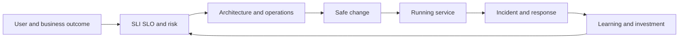

# SRE Decision Model

[← Module overview](index.md) · [Master competency map](../master-competency-map.md)

SRE is an operating discipline for managing reliability as an engineering and
business decision. It uses measurable objectives, software-based operations,
controlled change, incident learning, and sustainable human systems.

## Seven-part mental model

1. **Outcome** — critical user journey and business value to preserve.
2. **Objective** — SLI, SLO, recovery expectation, and risk tolerance.
3. **Architecture** — failure domains, dependencies, capacity, and recovery mechanisms.
4. **Operation** — ownership, on-call, procedures, automation, and observability.
5. **Change** — release, configuration, platform, dependency, and organizational risk.
6. **Response** — detection, command, mitigation, recovery, and communication.
7. **Learning** — postmortem, corrective work, validation, and updated objectives.

## Core SRE principles

- Define reliability from user-visible service behavior.
- Treat reliability as a feature with cost and opportunity trade-offs.
- Automate repetitive operations while preserving judgment and safe recovery.
- Design for fault containment and recovery rather than assuming fault prevention.
- Use incidents and near misses to improve systems, not to find a person to blame.
- Protect human capacity; chronic overload is a reliability defect.

## Reliability is not maximum availability

Higher availability can require more redundancy, complexity, coordination,
operational expertise, and cost. It may slow product learning or introduce new
failure modes. The appropriate target depends on user tolerance, critical flows,
contractual and safety obligations, alternatives, dependency capability, recovery,
and investment—not competitor marketing.

## SRE versus related practices

- **DevOps** is a broad culture and delivery approach; SRE is one concrete way to
  implement shared operations and engineering responsibility.
- **Platform engineering** creates reusable product-like capabilities; SRE defines
  and improves service reliability, sometimes by building those capabilities.
- **Operations** remains essential; SRE does not make coordination, maintenance,
  support, compliance, or human judgment disappear.
- **Observability** supplies evidence; SRE turns evidence into objectives, response,
  prioritization, and improvement.

## Architecture test

A credible SRE design can answer: What user behavior are we protecting? What
unreliability is acceptable? Which risks dominate? Who responds and with what
authority? How do we recover? Which recurring work should become engineering?
How will we know corrective work changed the outcome?

Return to the [module overview](index.md) when ready to continue.
