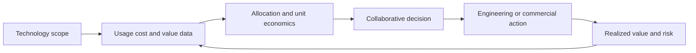

# FinOps Decision Model

[← Module overview](index.md) · [Master competency map](../master-competency-map.md)

FinOps makes technology-value decisions continuous and collaborative. It is not
finance policing engineering, an optimization tool, or a savings target detached
from revenue, customer experience, security, resilience, and delivery speed.

## Seven-part mental model

1. **Scope** — technology spend and business boundary being managed.
2. **Outcome** — value, efficiency, predictability, risk, or growth decision to improve.
3. **Data** — timely, accurate, normalized usage, cost, adjustment, and business data.
4. **Allocation** — accountable product, owner, environment, customer, or cost center.
5. **Economics** — total and unit cost, value measures, forecast, budget, and variance.
6. **Action** — architectural, usage, rate, product, procurement, or policy decision.
7. **Evidence** — realized value, operational impact, owner, and next iteration.

## Framework orientation

The FinOps Framework describes six collaborating core personas: Engineering,
FinOps Practitioner, Finance, Leadership, Procurement, and Product. Common allied
personas include security, sustainability, IT asset management, IT financial
management, and IT service management. The familiar Inform, Optimize, and Operate
phases are iterative, not a one-way project plan.

Current framework domains organize outcomes around understanding usage and cost,
quantifying business value, optimizing usage and cost, and managing the FinOps
practice. Capabilities are selected according to scope and need; maturity can
develop at different speeds across capabilities.

## Good FinOps decisions

- expose cost near the engineer’s decision point without hiding data quality;
- make product and business owners accountable for value, not just infrastructure teams;
- distinguish avoidable waste, efficient growth, and deliberate resilience cost;
- use central enablement for data, standards, education, and commercial leverage;
- decentralize workload decisions to teams that understand customer and technical impact;
- verify realized savings after fees, commitments, migration work, and demand changes.

## Architecture test

A credible FinOps design can answer: Which outcome is being improved? What cost
basis and scope are used? Who owns the decision? Which usage and business driver
explains change? What trade-off is accepted? How will realized value be measured?
What prevents the same inefficiency or surprise from returning?

Return to the [module overview](index.md) when ready to continue.
