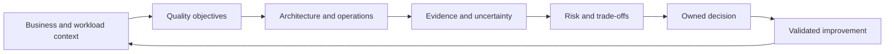

# Architecture-Review Decision Model

[← Module overview](index.md) · [Master competency map](../master-competency-map.md)

A review creates a shared, evidence-based understanding of whether a workload can
meet its business and quality objectives, which risks matter, and what should
happen next. Framework questions are prompts for discovery, not universal controls.

## Seven-part mental model

1. **Context** — workload purpose, users, value, lifecycle, criticality, and constraints.
2. **Objectives** — functional outcomes and measurable quality attributes.
3. **Architecture** — components, dependencies, data, trust, delivery, and operations.
4. **Evidence** — configurations, telemetry, tests, incidents, decisions, and owner testimony.
5. **Risk** — credible condition, cause, consequence, likelihood, and existing controls.
6. **Decision** — remediate, investigate, transfer, avoid, or accept with accountable authority.
7. **Learning** — validate action, update design and standards, and schedule reassessment.

## What a review is not

- It is not a security or compliance audit, though it can reveal related risks.
- It is not proof that a provider service or framework answer was implemented correctly.
- It is not a guarantee of reliability, security, performance, cost, or sustainability.
- It is not a replacement for threat modeling, SLOs, load testing, DR exercises, or FinOps.
- It is not architecture approval based on a single score or reviewer opinion.

## Quality attributes interact

Encryption can affect performance and operations. Multi-Region resilience can
increase cost, complexity, and environmental impact. Aggressive rightsizing can
reduce failure headroom. Fast delivery without observability can increase recovery
risk. The review must record such trade-offs rather than optimize one pillar in
isolation.

## Evidence ladder

Treat design statements as hypotheses. Confidence increases from verbal claim, to
diagram or document, to configuration, to operational telemetry, to controlled
test, to demonstrated behavior during representative demand or failure. Absence of
evidence is uncertainty—not automatic proof that a control is absent.

## Architecture test

A credible review can answer: What outcome and scope were reviewed? Who participated?
What evidence supports each material conclusion? Which assumptions remain? What are
the top risks and cross-pillar trade-offs? Who owns each decision? How and when will
improvement be validated, and what triggers the next review?

Return to the [module overview](index.md) when ready to continue.
